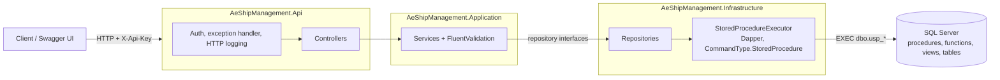

# AE Ship Management – Backend Code Challenge

A ship management backend built with **SQL Server stored procedures** and an **ASP.NET Core (.NET 10) REST API**, covering users, ships, ship assignment, crew lists and fiscal-year-aware financial reports.

The original brief is kept unchanged in [CHALLENGE.md](CHALLENGE.md).

- **Database:** SQL Server (tested on SQL Server 2022 Express), T-SQL only, compatible with Azure SQL Database
- **API:** C# / ASP.NET Core 10 (LTS), Dapper calling stored procedures only
- **Tests:** xUnit: 82 unit tests and 79 integration tests against a real SQL Server
- **Extras:** API key authentication, OpenAPI + Swagger UI, structured logging, health check, Docker Compose, GitHub Actions workflow

---

## Contents

1. [Quick start](#quick-start)
2. [How to verify](#how-to-verify)
3. [Architecture](#architecture)
4. [Database design](#database-design)
5. [Business rules](#business-rules)
6. [Stored procedures](#stored-procedures)
7. [API](#api)
8. [Error handling and validation](#error-handling-and-validation)
9. [Testing](#testing)
10. [Docker and CI](#docker-and-ci)
11. [Scalability considerations](#scalability-considerations)
12. [Open questions for the client](#open-questions-for-the-client)
13. [Project structure](#project-structure)

---

## Quick start

### Option A – Docker (SQL Server 2022 + API)

```bash
cp .env.example .env        # then set your own passwords and API key
docker compose up --build
```

- Swagger UI: http://localhost:8080/swagger
- Health: http://localhost:8080/health
- Send the API key from `.env` in the `X-Api-Key` header (Swagger UI: **Authorize**).

`db-init` creates the database, runs every script in `database/` and creates the execute-only `ae_api` login that the API uses.

### Option B – Local SQL Server Express (Windows)

Requirements: .NET SDK 10, SQL Server 2019+ (Express is enough) and `sqlcmd`.

```powershell
./database/deploy.ps1                           # defaults to localhost\SQLEXPRESS, Windows auth
dotnet run --project src/AeShipManagement.Api
```

- `deploy.ps1 -Server <instance> -User sa -Password <pwd>` targets another instance or SQL authentication.
- The launch profile runs in Development on http://localhost:5000 and opens Swagger UI at http://localhost:5000/swagger.
- Development settings use `localhost\SQLEXPRESS` (Windows authentication) and the API key `local-dev-api-key` (`appsettings.Development.json`, development only).

### Running the tests

```bash
dotnet test tests/AeShipManagement.UnitTests
dotnet test tests/AeShipManagement.IntegrationTests
```

Integration tests create a temporary database, deploy all scripts into it and drop it afterwards. They use `localhost\SQLEXPRESS` by default; set `AE_TEST_SQL_CONNECTION` to a master-database connection string to use another server.

---

## How to verify

A short checklist to confirm the main features against the sample data, using Swagger UI (**Authorize** with the API key) or `curl`.

```bash
BASE=http://localhost:8080/api/v1    # Docker; local run: http://localhost:5000/api/v1
KEY=change-me-api-key                # API_KEY from .env; local run: local-dev-api-key
```

### Crew list

Crew dates are generated relative to the day the database is deployed, so the counts below hold on that day. `CREW001` and `CREW002` keep the fixed dates from the brief.

| # | Request | Expected |
|---|---|---|
| 1 | `curl -s -H "X-Api-Key: $KEY" "$BASE/ships/SHIP01/crew"` | `totalCount` 22 (19 Onboard + 3 Relief Due). First rows by rank seniority: Master `CREW001` Soka Philip (Relief Due), Chief Engineer `CREW002` Masteros Philip (Relief Due), Chief Officer `CREW003` John Masterbear (Onboard) |
| 2 | `curl -s -H "X-Api-Key: $KEY" "$BASE/ships/SHIP01/crew?search=05%20Apr"` | Exactly one item: `CREW001`, `signOnDateDisplay` "05 Apr 2025" |
| 3 | `curl -s -H "X-Api-Key: $KEY" "$BASE/ships/SHIP01/crew?sortBy=age&sortDirection=desc&pageSize=5"` | 5 items, ages in descending order, `totalPages` 5 |
| 4 | `curl -s -H "X-Api-Key: $KEY" "$BASE/ships/SHIP01/crew?search=_"` | No items: `%` and `_` are searched as literal text |
| 5 | `curl -s -H "X-Api-Key: $KEY" "$BASE/ships/SHIP05/crew"` | `422`: SHIP05 is inactive |

### Financial reports

| # | Request | Expected |
|---|---|---|
| 6 | `curl -s -H "X-Api-Key: $KEY" "$BASE/ships/SHIP01/financial-reports/detail?period=2025-07"` | `ytdFrom` 2025-01, `ytdTo` 2025-07, rows below |
| 7 | `curl -s -H "X-Api-Key: $KEY" "$BASE/ships/SHIP02/financial-reports/detail?period=2025-02"` | `ytdFrom` 2024-04: SHIP02 uses the April–March fiscal year |
| 8 | `curl -s -H "X-Api-Key: $KEY" "$BASE/ships/SHIP01/financial-reports/summary?period=2025-07"` | 6 rows, all `"accountType": "Parent"` |

Selected rows of request 6 (SHIP01, July 2025):

| Account | Month actual | Month budget | Variance | YTD actual | YTD budget | YTD variance | What it shows |
|---|---:|---:|---:|---:|---:|---:|---|
| 7000000 OPERATING EXPENSES | 122,100 | 167,450 | −45,350 | 1,200,450 | 1,266,250 | −65,800 | Root = sum of all children |
| 7100000 AWARD AND GRANT TO INDIVIDUALS | 2,300 | 3,200 | −900 | 9,600 | 9,600 | 0 | Parent of the two accounts in the brief |
| 7120000 AWARDS | `null` | 1,000 | −1,000 | 3,200 | 3,300 | −100 | Example in the brief: no transactions → `null`, not 0 |
| 7135000 SCHOLARSHIPS | 2,300 | 2,200 | 100 | 6,400 | 6,300 | 100 | Example in the brief |
| 7540000 DRY DOCKING | `null` | 0 | 0 | 184,000 | 180,000 | 4,000 | Budget recorded as 0 stays 0; shown because YTD is non-zero |

The same numbers can be checked against the raw tables in SSMS or any SQL client:

```sql
-- SHIP01 July 2025 actual of the root account: 122100
SELECT SUM(t.ActualValue) FROM dbo.AccountTransaction t JOIN dbo.Ship s ON s.ShipId = t.ShipId
WHERE s.ShipCode = 'SHIP01' AND t.AccountPeriod = '2025-07-01';

-- SHIP02 YTD actual for February 2025 (April 2024 – February 2025): 1825650
SELECT SUM(t.ActualValue) FROM dbo.AccountTransaction t JOIN dbo.Ship s ON s.ShipId = t.ShipId
WHERE s.ShipCode = 'SHIP02' AND t.AccountPeriod BETWEEN '2024-04-01' AND '2025-02-01';
```

### Users, ships and errors

| # | Request | Expected |
|---|---|---|
| 9 | `curl -s -i -H "X-Api-Key: $KEY" -H "Content-Type: application/json" -d '{"fullName":"Test User","email":"test.user@example.com","roleName":"Superintendent"}' "$BASE/users"` | `201` with a `Location` header and the new `userId` |
| 10 | `curl -s -i -X PUT -H "X-Api-Key: $KEY" "$BASE/users/{userId}/ships/SHIP01"` | `204`; repeating it is also `204` |
| 11 | `curl -s -H "X-Api-Key: $KEY" "$BASE/users/{userId}/ships"` | `[{ "shipCode": "SHIP01", ... }]` |
| 12 | Request 9 again | `409`: the email already exists |
| 13 | `curl -s -i "$BASE/ships"` | `401`: no API key |
| 14 | `curl -s -i -H "X-Api-Key: $KEY" "$BASE/ships/SHIP01/financial-reports/detail?period=2025-13"` | `400` with an error for `period` |
| 15 | `curl -s -i -H "X-Api-Key: $KEY" "$BASE/ships/NOPE/crew"` | `404` |

All errors are returned as `application/problem+json` with a `traceId`.

---

## Architecture

A **modular monolith**: one REST API and one SQL Server database, split into layers with clear boundaries.



| Layer | Responsibility |
|---|---|
| `Api` | HTTP concerns only: routing, status codes, API key authentication, ProblemDetails, OpenAPI, logging |
| `Application` | Use cases, request/response models, input validation, repository interfaces. No SQL, no HTTP |
| `Infrastructure` | Repository implementations. Every call goes through one `StoredProcedureExecutor` that always uses `CommandType.StoredProcedure` and translates SQL errors to application exceptions |
| `database/` | Schema, functions, views, stored procedures and sample data: the single source of truth for business calculations |

**Why not microservices?** The brief asks for REST APIs over one SQL Server database. Everything revolves around the ship (crew, finance, users), so splitting into services would add network hops, data duplication and operational cost with no benefit at this size. The feature folders (Users, Ships, Crew, FinancialReports) keep boundaries clear, so a module could be extracted later if load or team structure required it.

**Stored-procedure-only access is enforced, not just followed.** The API connects as `ae_api`, a login that only has `EXECUTE` on schema `dbo` (`database/security/api_login.sql`). Direct `SELECT`/`UPDATE` on tables or views fails with error 229. This is covered by integration tests.

Other choices:

- **.NET 10 (LTS)**: .NET 8 support ended in November 2026. The brief does not mandate a version.
- **Dapper** instead of an ORM: with stored procedures only, change tracking and LINQ add nothing. Dapper maps procedure results (including multiple result sets and output parameters) explicitly.
- **Typed parameters**: strings are sent with the exact SQL type and length of the column (`varchar(10)`, `nvarchar(100)`, `char(4)`), avoiding implicit conversions that prevent index seeks.
- **Central Package Management** (`Directory.Packages.props`) and `TreatWarningsAsErrors` for consistent builds.

---

## Database design

ERD: [database/ERD.md](database/ERD.md) (Mermaid, rendered by GitHub).

One database object per file, so each procedure or function can be read and reviewed on its own:

| Path | Content |
|---|---|
| `schema.sql` | Tables, primary/foreign keys, check constraints, indexes |
| `views/` | `vw_AccountTree`, `vw_AccountHierarchy` (chart-of-accounts tree and ancestor/descendant closure) |
| `functions/` | Inline table-valued functions reused by procedures: `fn_CrewStatus`, `fn_AgeInYears`, `fn_FormatDisplayDate`, `fn_FiscalYtdRange`, `fn_ContainsPattern`, `fn_FinancialReport` |
| `procedures/` | The 14 stored procedures used by the API, one `usp_*.sql` file each |
| `seed/reference_data.sql` | Fiscal year types, nationalities, ranks, roles, chart of accounts |
| `seed/sample_data.sql` | Ships, users, crew and service history, budgets, actual transactions |
| `security/api_login.sql` | Execute-only login/user for the API (optional, parameterised) |
| `deploy-order.txt` | Execution order (dependencies first), used by `deploy.ps1`, `deploy.sh` and the integration tests |

Key decisions:

| Decision | Reason |
|---|---|
| `FiscalYearType` table (`0112`, `0403`, …) with computed start/end month and a check constraint | No hard-coded fiscal years. A new fiscal year type is one row. The constraint rejects codes that are not 12 consecutive months (e.g. `0412`). |
| Crew status is **derived** from dates, never stored | It changes every day without any data change, so a stored value would go stale. |
| Rank stored per contract in `CrewServiceHistory` | A crew member can be promoted between contracts. |
| `AccountPeriod` is a `DATE` on the first day of the month (`CHECK DAY() = 1`) | Fiscal-year ranges become index-friendly date ranges. The API accepts `yyyy-MM`. |
| Money is `DECIMAL(18,2)` with `CHECK (value >= 0)` | Exact arithmetic. Negative budgets/actuals are rejected by the database. |
| Budgets and actuals can only reference **child** accounts, enforced by a composite foreign key | `Account` has `UNIQUE (AccountNumber, AccountType)`. Budget/transaction rows carry a computed `AccountType = 'C'` and reference that pair. A parent reference must point to a `'P'` account the same way. No triggers needed. |
| Surrogate `ShipId` with unique `ShipCode` | Codes can change without touching foreign keys. The API exposes the business code. |
| Lookup tables for rank, nationality, role | Normalisation and consistent values. |
| Filtered index on open contracts (`WHERE SignOffDate IS NULL`) | The crew list only reads contracts that are not signed off. |

Sample data (all minimums in the brief are checked by an integration test):

- 6 ships: 4 active and 2 inactive, fiscal years `0112` and `0403`
- 20+ crew per ship (152 crew members, 179 contracts), 19 ranks, realistic handovers with overlapping service periods, previous contracts on other ships
- Chart of accounts: 3 levels, 8 parent accounts with 5–7 children each
- Budgets for 3 ships (one `0403`), January 2024 – December 2025, for 10 child accounts (two in each of five account groups); the other accounts exist in the chart of accounts without values
- Actual transactions for the same 3 ships and accounts, January 2024 – October 2025, one or two rows per period, including zero-value rows and periods without rows
- About 1,900 rows in total (721 budget rows, 696 transactions), small enough to check by hand
- Crew dates are offsets from the day the script runs, so Onboard, Relief Due, Planned and Signed Off crew exist whenever the data is loaded. The README sample rows (`CREW001`, `CREW002`) keep their original fixed dates.
- `SHIP01` accounts `7120000` and `7135000` reproduce the child rows of the example report for July 2025.

---

## Business rules

### Crew status (as of today, or `@AsOfDate` in tests)

| Condition | Status | In crew list |
|---|---|---|
| Sign Off Date is set | Signed Off | No |
| Sign On Date is after today | Planned | No |
| No Sign Off Date and today > End of Contract + 30 days | Relief Due | Yes |
| Signed on, no Sign Off Date, otherwise | Onboard | Yes |

The rules live in one place: `dbo.fn_CrewStatus`. See [open questions](#open-questions-for-the-client) for the window between End of Contract and End of Contract + 30 days.

Age is computed in completed years (`dbo.fn_AgeInYears`). `DATEDIFF(YEAR)` alone over-counts before the birthday.

### Financial reports

- **YTD range:** `start month = first two digits of the fiscal year code`. If the selected month is before the start month, the fiscal year started in the previous calendar year. For example, `0403` + February 2025 gives April 2024 – February 2025, and `0112` + July 2025 gives January – July 2025.
- **Child values** are the sum of all recorded rows. No rows means `NULL` (unknown, shown as `null`). A recorded zero stays `0`.
- **Parent values** are the sum of all descendant child accounts at any depth, via a recursive closure view (`vw_AccountHierarchy`).
- **Variance** = Actual − Budget. When only one side has a value, the missing side counts as zero. When both are missing, the variance is `NULL`.
- Accounts whose monthly and YTD values are all zero or missing are not returned.
- **Detail** returns every account level. **Summary** returns parent accounts only.
- Reports and crew lists are only available for **active** ships (`422` for inactive ships).

**Note on the example report in the brief:** its child rows are reproduced exactly by the sample data (`7120000` and `7135000`, July 2025), and `7100000` holds only those two accounts, as in the example, so its YTD actual is 9,600. Some parent figures in the example do not add up (for example, 9600 − 9900 is shown as a YTD variance of 0), so the implementation follows the stated rules (parent = sum of children, variance = actual − budget) rather than those figures.

---

## Stored procedures

| Procedure | Purpose |
|---|---|
| `usp_User_Create`, `usp_User_GetById`, `usp_User_List`, `usp_UserRole_List` | Users and roles |
| `usp_Ship_Create`, `usp_Ship_GetByCode`, `usp_Ship_List` | Ships |
| `usp_UserShip_Assign`, `usp_UserShip_Unassign`, `usp_UserShip_ListShipsByUser` | User ↔ ship assignment (many-to-many). Assign is idempotent. |
| `usp_Crew_ListByShip` | Crew list with paging, sorting and searching |
| `usp_FinancialReport_Detail`, `usp_FinancialReport_Summary` | Financial reports (shared implementation in `usp_FinancialReport_Get`) |

**Crew list parameters:** `@PageNumber` (1-based), `@PageSize` (1–100), `@SortBy` (`RankName`, `CrewMemberId`, `FirstName`, `LastName`, `Age`, `Nationality`, `SignOnDate`, `Status`; default rank seniority), `@SortDirection` (`ASC`/`DESC`), `@SearchTerm`, and `@TotalCount OUTPUT`.

**SQL injection safety:**

- There is **no dynamic SQL**. Sorting uses a whitelist and static `CASE` expressions in `ORDER BY`.
- Search input is always a parameter, and LIKE wildcards (`%`, `_`, `[`) are escaped (`fn_ContainsPattern`), so `%` means a literal percent sign.
- Search covers every column except Status, including the displayed date (`dd Mon yyyy`, e.g. `05 Apr`) and the ISO date. The display format is built from a fixed month table, so it does not depend on the session language.

**Error convention:** procedures raise `THROW 50400` (invalid input), `50404` (not found), `50409` (conflict) or `50422` (business rule), and the API maps them to HTTP status codes.

---

## API

Base path `/api/v1`. All endpoints except `/health`, `/openapi/v1.json` and `/swagger` require the `X-Api-Key` header. OpenAPI document: [docs/openapi.json](docs/openapi.json).

| Method | Endpoint | Success | Description |
|---|---|---|---|
| POST | `/users` | 201 + Location | Create a user (`fullName`, `email`, `roleName`) |
| GET | `/users?pageNumber=&pageSize=` | 200 | List users (paged) |
| GET | `/users/{userId}` | 200 | Get a user |
| GET | `/user-roles` | 200 | Roles a user can have |
| POST | `/ships` | 201 + Location | Create a ship (`shipCode`, `shipName`, `fiscalYearCode`, optional `status`) |
| GET | `/ships?status=&pageNumber=&pageSize=` | 200 | List ships (paged, optional status filter) |
| GET | `/ships/{shipCode}` | 200 | Get a ship |
| PUT | `/users/{userId}/ships/{shipCode}` | 204 | Assign a ship to a user (idempotent) |
| DELETE | `/users/{userId}/ships/{shipCode}` | 204 | Remove an assignment |
| GET | `/users/{userId}/ships` | 200 | Ships assigned to a user |
| GET | `/ships/{shipCode}/crew?pageNumber=&pageSize=&sortBy=&sortDirection=&search=` | 200 | Crew Onboard / Relief Due as of today |
| GET | `/ships/{shipCode}/financial-reports/detail?period=yyyy-MM` | 200 | Detailed financial report |
| GET | `/ships/{shipCode}/financial-reports/summary?period=yyyy-MM` | 200 | Summary financial report |
| GET | `/health` | 200 | API and database health (no API key) |

Example:

```bash
curl -H "X-Api-Key: local-dev-api-key" \
  "http://localhost:5000/api/v1/ships/SHIP01/financial-reports/detail?period=2025-07"
```

```json
{
  "shipCode": "SHIP01",
  "shipName": "Flying Dutchman",
  "fiscalYearCode": "0112",
  "reportType": "Detail",
  "period": "2025-07",
  "ytdFrom": "2025-01",
  "ytdTo": "2025-07",
  "rows": [
    {
      "accountNumber": "7120000",
      "coaDescription": "AWARDS",
      "accountType": "Child",
      "level": 3,
      "parentAccountNumber": "7100000",
      "actual": null,
      "budget": 1000.00,
      "variance": -1000.00,
      "ytdActual": 3200.00,
      "ytdBudget": 3300.00,
      "ytdVariance": -100.00
    }
  ]
}
```

---

## Error handling and validation

Every error is an RFC 9457 `application/problem+json` response with a `traceId`:

| Status | When |
|---|---|
| 400 | Validation failed (field errors per property), malformed JSON, invalid paging/sorting, unknown fiscal year code or role |
| 401 | Missing or invalid API key |
| 404 | User, ship or assignment not found |
| 409 | Duplicate ship code or e-mail (case-insensitive), including unique-index races |
| 422 | Business rule: crew list or report requested for an inactive ship |
| 500 | Unexpected error. Generic message only; details are logged, never returned. |

Validation happens twice on purpose:

- **FluentValidation in the API** gives clear field-level messages and enforces column lengths. Without this, a 15-character ship code would be silently truncated to `varchar(10)`.
- **The procedures validate again**, because they are the system's contract and can be called by other clients.

Logging uses `ILogger` with structured properties: HTTP method/path/status/duration, created users and ships, assignments, rejected API keys, and unhandled exceptions.

---

## Testing

| Project | Count | What it covers |
|---|---|---|
| `AeShipManagement.UnitTests` | 82 | Validators, services (NSubstitute fakes), SQL error translation, exception-to-HTTP mapping, and the full HTTP pipeline in memory via `WebApplicationFactory` (authentication, status codes, ProblemDetails, null vs zero in JSON) |
| `AeShipManagement.IntegrationTests` | 79 | Deploys the real scripts to a temporary SQL Server database. Covers crew status at every date boundary, age around birthdays and 29 February, search (partial dates, wildcards, injection strings), paging, sorting every column in both directions, YTD for `0112` and `0403`, parent roll-ups, NULL vs 0, summary vs detail, constraint enforcement, execute-only permissions, sample-data minimums, and end-to-end HTTP flows |

### Key tests

A short path through the suite: the ten tests that best show the business rules, the edge cases and the security checks.

| Test | Type | What it proves |
|---|---|---|
| [`Status_rules_are_applied_at_each_date_boundary`](tests/AeShipManagement.IntegrationTests/CrewListProcedureTests.cs#L44) | Integration | Onboard at End of Contract and at + 30 days, Relief Due at + 31 days, Onboard on the sign-on day |
| [`Age_is_counted_in_completed_years`](tests/AeShipManagement.IntegrationTests/CrewListProcedureTests.cs#L67) | Integration | Age changes on the birthday, not before, including a 29 February birth date |
| [`Search_treats_input_as_literal_text`](tests/AeShipManagement.IntegrationTests/CrewListProcedureTests.cs#L112) | Integration | `%`, `_`, `[A-Z]` and an injection string find nothing and change nothing |
| [`Child_rows_match_the_example_in_the_brief`](tests/AeShipManagement.IntegrationTests/FinancialReportProcedureTests.cs#L12) | Integration | AWARDS and SCHOLARSHIPS for July 2025 match the brief, including the `null` actual |
| [`Ytd_range_follows_the_ship_fiscal_year`](tests/AeShipManagement.IntegrationTests/FinancialReportProcedureTests.cs#L72) | Integration | YTD start for `0112` and `0403`, including January, March, April and December |
| [`Recorded_zero_and_missing_value_stay_distinct`](tests/AeShipManagement.IntegrationTests/FinancialReportProcedureTests.cs#L95) | Integration | No transactions stays `NULL`, a recorded zero stays `0` |
| [`Execute_only_user_cannot_touch_tables_or_views_directly`](tests/AeShipManagement.IntegrationTests/ExecuteOnlyPermissionTests.cs#L41) | Integration | A login with EXECUTE only gets error 229 on direct SELECT or UPDATE |
| [`Crew_sort_rejects_unknown_columns`](tests/AeShipManagement.UnitTests/Validation/CrewAndReportValidatorTests.cs#L27) | Unit | Sort columns are whitelisted; `RankName; DROP TABLE dbo.Ship` is rejected |
| [`Invalid_crew_query_never_reaches_the_database`](tests/AeShipManagement.UnitTests/Services/ServiceTests.cs#L46) | Unit | Invalid input stops in the service; the repository is never called |
| [`Unexpected_failure_returns_500_without_internal_details`](tests/AeShipManagement.UnitTests/Api/ApiPipelineTests.cs#L180) | Unit | An unexpected error returns 500 without leaking its message |

Run only these ten (24 cases, since some are theories) from the repository root:

```bash
dotnet test --filter "FullyQualifiedName~Status_rules_are_applied_at_each_date_boundary|FullyQualifiedName~Age_is_counted_in_completed_years|FullyQualifiedName~Search_treats_input_as_literal_text|FullyQualifiedName~Child_rows_match_the_example_in_the_brief|FullyQualifiedName~Ytd_range_follows_the_ship_fiscal_year|FullyQualifiedName~Recorded_zero_and_missing_value_stay_distinct|FullyQualifiedName~Execute_only_user_cannot_touch_tables_or_views_directly|FullyQualifiedName~Crew_sort_rejects_unknown_columns|FullyQualifiedName~Invalid_crew_query_never_reaches_the_database|FullyQualifiedName~Unexpected_failure_returns_500_without_internal_details"
```

Other useful filters:

```bash
dotnet test --filter "FullyQualifiedName~CrewListProcedureTests"
dotnet test --filter "Category=Integration"
```

Integration tests need a SQL Server. With only Docker available, start the database container and point the tests at it (use the `MSSQL_SA_PASSWORD` from `.env`):

```bash
docker compose up -d sqlserver
AE_TEST_SQL_CONNECTION="Server=localhost,1433;Database=master;User Id=sa;Password=<MSSQL_SA_PASSWORD>;TrustServerCertificate=true" dotnet test tests/AeShipManagement.IntegrationTests
```

In PowerShell, set it with `$env:AE_TEST_SQL_CONNECTION = "..."` before `dotnet test`.

---

## Docker and CI

- `Dockerfile`: multi-stage build, runs as the non-root `app` user.
- `docker-compose.yml`: `sqlserver` (2022, health-checked) → `db-init` (runs `database/deploy.sh`) → `api`. The API connects with the execute-only `ae_api` login. Secrets come from `.env` (template: `.env.example`).
- `.github/workflows/ci.yml` (GitHub Actions):
  - restore, build (warnings as errors), unit tests, integration tests against a SQL Server 2022 service container;
  - then `docker compose up` with a smoke test (health, crew list, report, 401 without key).

GitHub Actions is not enabled on this repository. The same pipeline can be run locally:

```bash
dotnet build --configuration Release
dotnet test tests/AeShipManagement.UnitTests --configuration Release
dotnet test tests/AeShipManagement.IntegrationTests --configuration Release
docker compose up --build
```

---

## Scalability considerations

- **Stateless API:** scale horizontally behind a load balancer. Connection pooling is provided by SqlClient.
- **Bounded responses:** every list is paged (max 100 rows), and `@TotalCount` comes from the same procedure call.
- **Indexes match access paths:** `(ShipId, AccountPeriod)` with included columns for reports, and a filtered index for open crew contracts.
- **Async I/O and cancellation tokens** throughout, so aborted requests stop their SQL commands.
- If financial data grows large: a monthly summary table or indexed view per ship/account, partitioning by period, and caching reports for closed periods.
- Read-heavy reporting could move to a readable secondary (Azure SQL read scale-out) without code changes beyond the connection string.
- The API is versioned in the URL (`/api/v1`).

---

## Open questions for the client

The brief leaves some behaviour open. These are the current choices. Each is isolated in one place so it can change quickly once confirmed.

| # | Question | Current behaviour | Where |
|---|---|---|---|
| 1 | Crew with no Sign Off Date whose End of Contract passed **1–30 days** ago | Onboard | `fn_CrewStatus` |
| 2 | Sign Off Date set but in the future | Signed Off (excluded), following "If the Sign Off Date is set…" literally | `fn_CrewStatus` |
| 3 | Several budget rows for the same ship/account/period (sample shows 0 and 1000) | Summed | `fn_FinancialReport` |
| 4 | Variance when only one side has data | Missing side counts as 0; both missing → NULL | `fn_FinancialReport` |
| 5 | "Only include records where budget or actual values are non-zero" | Row shown when any monthly or YTD value is non-zero | `fn_FinancialReport` |
| 6 | Content of the summary report | Parent accounts only | `usp_FinancialReport_Get` |
| 7 | Inactive ship in crew list / report | 422 with an explanatory message | crew and report procedures |
| 8 | Search: one keyword across columns or per-column filters | One keyword across all columns except Status | `usp_Crew_ListByShip` |

---

## Project structure

```
├── CHALLENGE.md                         original brief
├── database/                            T-SQL scripts, ERD, deploy scripts
├── docs/openapi.json                    exported OpenAPI 3.1 document
├── src/
│   ├── AeShipManagement.Api/            controllers, auth, error handling, OpenAPI
│   ├── AeShipManagement.Application/    models, validators, services, repository interfaces
│   └── AeShipManagement.Infrastructure/ Dapper repositories, stored procedure executor
├── tests/
│   ├── AeShipManagement.UnitTests/
│   └── AeShipManagement.IntegrationTests/
├── Dockerfile, docker-compose.yml, .env.example
└── .github/workflows/ci.yml
```
